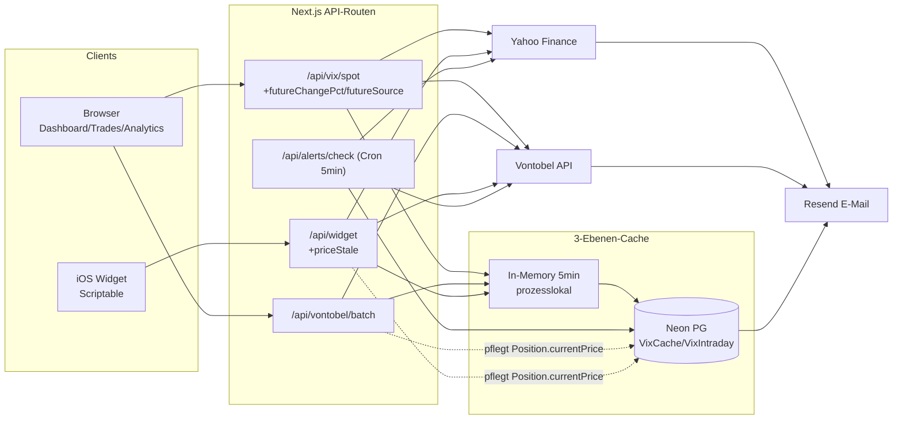

# 🏗️ Architektur — VIX Trading Dashboard

> Kompakte Übersicht. Details zu Sessions/Änderungen in `CHECKPOINT.md`.
> Zuletzt aktualisiert: 2026-07-01 (Session 9)

## Stack

| Ebene | Technologie |
|---|---|
| Framework | Next.js 16 (App Router) + React 19, TypeScript |
| Styling | Tailwind CSS v4 |
| Charts | Recharts 3 — **per `next/dynamic` nachgeladen, alle memoized, Animationen aus** |
| Client-Daten | SWR 2 (5-Min-Polling nur Mo–Fr 07:00–22:30 CET, `lib/trading-hours.ts`) |
| ORM/DB | Prisma 5 + Neon PostgreSQL (serverless, EU) — ⚠ auch lokal = Produktion |
| E-Mail | Resend (Alert-Versand) |
| Hosting | Hostinger, Node 22 — Auto-Deploy bei Push auf `main` |
| Marktdaten | Yahoo Finance (`^VIX`, `^VIX3M`, `ES=F`, EUR/USD) + Vontobel Chart-API (Zertifikate/Future) |

## Datenfluss

## Kernprinzipien

- **Single Source of Truth für Preise:** Server berechnet VX-Änderung (`futureChangePct` + `futureSource: vontobel|yahoo-vix3m`) — Dashboard und Widget zeigen identische Werte.
- **Stale-Fallback:** `Position.currentPrice` = letzter erfolgreicher Vontobel-Bid (von Widget- + Batch-Route gepflegt). Bei Vontobel-Ausfall zeigt das Widget diesen Wert mit `priceStale: true` (`~`-Präfix, graue P&L).
- **Status-Kopplung:** Position ↔ Trade synchron — Trade-PUT mit `exitDate` schließt die Position; Position-DELETE schließt verknüpfte offene Trades atomar (`$transaction`, exitPrice aus gecachtem Bid).
- **Cron:** `GET /api/alerts/check` (Bearer `CRON_SECRET`), parallelisierte Fetches, gebatchte DB-Reads, 30-Min-Cooldown pro Alert-Typ.

## Datenbank (Prisma-Modelle)

`Settings` (id=1, Thresholds/ISIN) · `Position` (offen/geschlossen, currentPrice = letzter Bid) · `Trade` (Kauf/Verkauf, Index auf `positionId`) · `AlertLog` · `VixCache` (generischer JSON-KV inkl. `vontobel_<ISIN>`, `account_capital`) · `VixIntraday` (5-Min-Kerzen)

## Umgebungsvariablen

`DATABASE_URL` / `DIRECT_URL` (Neon) · `RESEND_API_KEY` · `CRON_SECRET` — gesetzt im Hostinger-Dashboard.

## Dev-Hinweise

- Projekt liegt in iCloud Drive → Turbopack-`.next`-Panics möglich; Fix: `rm -rf .next ".next 2"`. Verlässliches Gate: `npm run build`.
- Kein Test-Framework — Verifikation über Build + Live-Curls + Preview/iPhone.
